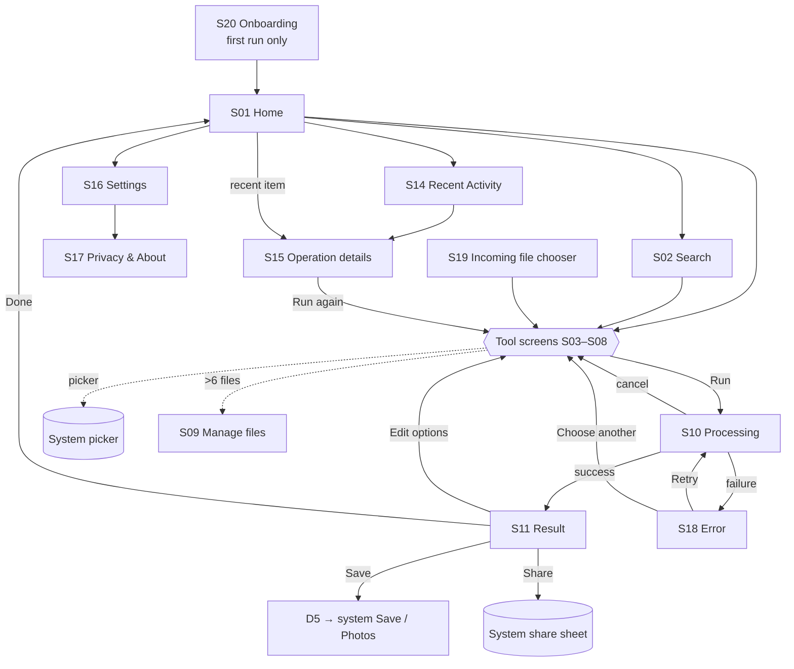
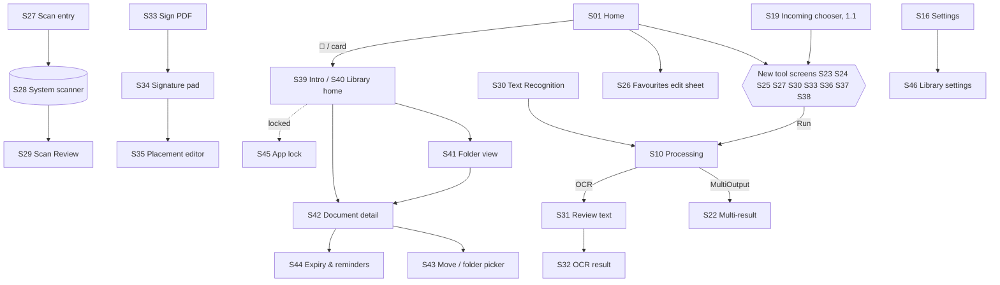

# DocuKit — Screen Specifications

Every screen gives: **route · entry points · layout · controller state · actions · states · platform notes · accessibility · requirements covered**. The wireframes are phone portrait at 360–430 dp wide. The component names (`ToolCard`, `InputsSection`, …) are defined in `DESIGN_SYSTEM.md §6`; the string keys are in `COPY.md`.

---

> **v2.1, ADR-035: bottom banners.** An anchored adaptive banner (`AppBottomBanner`, in reserved space below all content) appears on S01 Home, S02 Search, S11 Result, S14 Recent activity, S15 Operation details (`ADMOB_BANNER_MAIN`); S03–S08 and S09 Manage files (`ADMOB_BANNER_TOOLS`, with a 24 dp gap + 1 dp divider below the action button or selection bar); S17 Privacy & About and Licences (`ADMOB_BANNER_INFO`); and S16 Settings (`ADMOB_BANNER_SETTINGS`, AD-5). Never on S20, the tour, S10, S18, dialogs/sheets or the page preview. It collapses with no ad, after Remove ads, during the ad-free pass, the tour, an open keyboard or an open dialog/sheet.

## 0. Navigation map



**v3 additions (1.1–1.5; specs in `docs/features/RELEASE_V1_x.md`):**


S21 (batch inputs) lives inside the image tool screens when ≥ 2 images are picked.

### Route table (go_router)

| Route | Screen | Params | Back goes to |
|---|---|---|---|
| `/` | S01 Home | — | exit app (Android) |
| `/onboarding` | S20 | — | — (replaced by `/`) |
| `/search` | S02 | `?q=` | Home |
| `/tool/:toolId` | S03–S08 | `toolId` ∈ catalogue; `?from=history:<opId>` prefills options | Home (D4 if there are inputs) |
| `/tool/:toolId/review` | S09 full screen | — | the tool screen |
| `/tool/pdf-organize/preview/:page` | page preview (FR-ORG-08) | page index | the Organizer |
| `/job/:jobId` | S10 → S11/S18 (one route; the body switches on `JobState`) | `jobId` | see S10 |
| `/history` | S14 | — | Home |
| `/history/:opId` | S15 | `opId` | History or Home |
| `/settings` | S16 | — | Home |
| `/settings/privacy` | S17 | — | Settings |
| `/settings/licenses` | Flutter `LicensePage` (themed) | — | Privacy |
| `/incoming` | S19 | — | exit/Home |
| `/tool/image-convert` (1.1) | S23 Convert Image | — | Home |
| `/tool/pdf-split` (1.1) | S24 Split PDF | — | Home |
| `/tool/pdf-to-images` (1.1) | S25 PDF to Images | — | Home |
| `/tool/scan` (1.2) | S27 → S29 Scan Review | `?autostart=1` (quick action / shortcut) | Home (D4 if there are pages) |
| `/tool/ocr` (1.3) | S30 Text Recognition | — | Home |
| `/job/:jobId/text` (1.3) | S31 Review text (full screen, no ads) | `jobId` | S32 / Result |
| `/tool/pdf-sign` (1.4) | S33 Sign PDF | — | Home |
| `/tool/pdf-sign/create` (1.4) | S34 Signature pad (full screen, no ads) | `?mode=draw|type|photo` | S33 |
| `/tool/pdf-sign/place` (1.4) | S35 Placement editor (full screen, no ads) | — | S33 |
| `/tool/pdf-watermark` (1.4) | S36 Watermark PDF | — | Home |
| `/tool/pdf-protect` (1.4) | S37 Protect PDF | — | Home |
| `/tool/pdf-unlock` (1.4) | S38 Unlock PDF | — | Home |
| `/library` (1.5) | S39 intro (first visit) / S40 Library home | — | Home |
| `/library/folder/:id` (1.5) | S41 Folder view | `id` | parent folder / Library |
| `/library/doc/:id` (1.5) | S42 Document detail | `id` | the folder / Library |
| `/settings/library` (1.5) | S46 Library settings | — | Settings |
| `/lock` (1.5) | S45 App lock | `?next=` (validated against this table) | Home (Library-only scope) |

Library routes and `/settings/library` are lock-scoped (RELEASE_V1_5 §4.10); unknown library ids → `/library` with "That item is no longer in My Documents."

Deep-link safety: an unknown `toolId` or `opId` → Home with the snackbar "That item is no longer available."

---

## S01 · Home

> **v3 (1.1–1.5) layout — FULL_PRODUCT §3.** With 16 tools, Home becomes: hero (greeting · search · saved stat) → ★ Favourites (up to 6, hidden until one is pinned, 1.1) → Quick actions → collapsible category sections **Image** (Compress · Resize · Convert · Images→PDF), **PDF** (Merge · Organize · Split · PDF→Images · Reduce), **Scan & Text** (Scan · Text recognition, 1.2/1.3), **Secure & Sign** (Sign · Watermark · Protect · Unlock, 1.4), **My Documents** card (3 recent docs + "Open library", 1.5) → Recent. App bar: ? (tour) · 📁 My Documents (1.5) · 🕘 History · ⚙︎ Settings. **No bottom navigation bar** (ADR-035 banners). Each section is added by its release; the v1.0 layout below stays until then.

**Entry:** app launch (after S20 on first run), the Done button on Result, back from tools.

```
┌──────────────────────────────────────┐
│ DocuKit                    🕘  ⚙︎     │  App bar: title; History; Settings
├──────────────────────────────────────┤
│ ┌──────────────────────────────────┐ │
│ │ 🔍  Search tools — "make photo…" │ │  SearchBarButton → /search (hero)
│ └──────────────────────────────────┘ │
│ [▶ Continue: Image Compressor]       │  Continue chip (FR-HOME-05, hidden if none)
│                                      │
│ IMAGE TOOLS                          │  SectionHeader
│ ┌───────────┐ ┌───────────┐          │
│ │ 🗜 Compress│ │ ↔ Resize   │          │  ToolCard grid: 2 cols (<600dp),
│ │ Make photos│ │ Set exact  │          │  3 cols (600–839), 4 cols (≥840)
│ │ smaller    │ │ size       │          │
│ └───────────┘ └───────────┘          │
│ ┌───────────┐                        │
│ │ 🖼→📄 Images│                        │
│ │ to PDF     │                        │
│ └───────────┘                        │
│ PDF TOOLS                            │
│ ┌───────────┐ ┌───────────┐          │
│ │ ⊕ Merge    │ │ ▦ Organize │          │
│ └───────────┘ └───────────┘          │
│ ┌───────────┐                        │
│ │ ⇩ Reduce   │                        │
│ │ size       │                        │
│ └───────────┘                        │
│ RECENT                     See all › │
│ ┌──────────────────────────────────┐ │
│ │ 🗜 IMG_2041_compressed.jpg        │ │  RecentRow ×≤5
│ │ 3.2 MB → 410 KB · 2 min ago   ✓  │ │
│ ├──────────────────────────────────┤ │
│ │ ⊕ Merged_20261021.pdf  ⚠ unavail. │ │
│ └──────────────────────────────────┘ │
│ 🔒 Files never leave your phone      │  PrivacyFooter → S17
└──────────────────────────────────────┘
```

**Controller:** `homeControllerProvider` → `HomeState { List<RecentItem> recents; ToolId? lastTool; bool loading; }`. Recents stream from `historyRepository.watchRecent(5)`; availability resolved asynchronously per row.

**Actions:** tap a ToolCard → `/tool/:id`; tap the search bar → `/search`; tap a recent row → `/history/:opId`; long-press a recent row → context sheet (Open, Share, Remove from history).

**States:**
| State | Display |
|---|---|
| First run / no history | Recent section replaced by `EmptyHint`: "Your finished files will show up here." Tool cards show subtitles (FR-HOME-04) |
| Loading recents | 2 skeleton rows (≤ 300 ms, then the content) |
| Output unavailable | Row is dimmed, with the badge "File no longer available"; tapping still opens S15 |
| A job is running (rare: the user navigated Home) | Top banner: "Processing… Tap to view" → `/job/:id` |

**Platform:** Android back from Home exits. iOS: a large-title-style header is optional (`SliverAppBar.large`). Tablet ≥ 840 dp: `NavigationRail` (Home, History, Settings) replaces the app bar icons.
**A11y:** each ToolCard is one semantics node: "Image Compressor. Make photos smaller. Button." The recent row reads the name, sizes, time and status.
**Covers:** FR-HOME-01/03/04/05.

**v2.1 (UI_REFRESH §2, ADS.md §3, TOUR.md):**
- App bar gets a **help (?)** icon (tooltip "Take the tour") before History/Settings; it replays the Home tour (FR-TOUR-05). On tablets the rail keeps History/Settings and the (?) sits in the hero.
- Hero: time-of-day greeting (`home_greeting_morning/afternoon/evening`), `surfaceGlass` search bar, and the **savings chip** "You've saved {size} so far" (hidden when 0; FR-HOME-07).
- **Quick actions** row (horizontal chips) below the hero: Passport photo · Under 100 KB · Signature · Photos to PDF · Merge PDFs · Email-size PDF (UI_REFRESH §2.1; FR-HOME-06).
- Section headers become sentence case ("Image tools"); tool cards become **ToolCard v2** (UI_REFRESH §3).
- **AD-1** (native, small): between the PDF tools grid and Recent, 24 dp above/below; hidden during the tour, on first launch, and when no ad is loaded. **AD-9** (Phase B only): after Recent, above the privacy footer.
- Tour target keys: search bar, each tool card, the Recent section, the app-bar actions (TOUR.md §2).

---

## S02 · Search Tools

```
┌──────────────────────────────────────┐
│ ←  [ reduce photo size        ✕ ]    │  Autofocus TextField in the app bar
├──────────────────────────────────────┤
│ 🗜 Image Compressor                   │  ResultRow: icon, title, matching-phrase hint
│    Matches "reduce photo size"       │
│ ↔ Image Resizer                       │
│    Matches "size"                    │
└──────────────────────────────────────┘
Empty query  → "Try: compress, combine PDF, passport photo, rotate page"  (tap chips fill the query)
No results   → "No tool matches “xyz”." + list of all 6 tools
```
**Logic:** `FEATURE_SPECS.md §1`. Debounce 0 ms (local), the ranking runs on every keystroke. Enter/Search on the keyboard opens the top result.
**Covers:** FR-HOME-02.

---

## Shared layout for tool screens (S03–S08)

Every tool screen uses `ToolScaffold`:

```
┌──────────────────────────────────────┐
│ ←  Image Compressor            ⓘ     │  ⓘ = "How it works" bottom sheet
├──────────────────────────────────────┤
│ ① FILES                               │  InputsSection (S09 embedded)
│   [ empty: big "Choose image" drop    │
│     card + supported formats line ]   │
│   or FileTile list with badges        │
│ ② OPTIONS                             │  tool-specific OptionGroups
│   ...                                 │
│                                      │
├──────────────────────────────────────┤
│ Estimated: ~400 KB (shown only when  │  Optional hint line
│ known, e.g. resize dims)             │
│ [        Compress image        ]     │  PrimaryActionBar (sticky, safe-area aware)
└──────────────────────────────────────┘
```

Shared rules:
- The primary button is **disabled** until the inputs are valid; a helper text under it says why ("Add at least 2 PDFs").
- Options are pre-filled from Settings defaults or `?from=history` options; changes update the draft (`draft_<tool>`) for FR-LIFE-03.
- Back with inputs → D4. Back with no inputs → pop.
- Pressing the primary button → `JobRunner.start(...)` → `context.push('/job/$id')`.
- After Result → "Edit options", the user returns here with the inputs and options intact (FR nav rule).

### S09 · File Selection Review (`InputsSection` + `/tool/:id/review`)

```
FILES (3)                                   + Add
┌──────────────────────────────────────────────┐
│ ≡ [thumb] IMG_2041.HEIC         ⋮            │  FileTile: drag handle (multi only),
│          4032×3024 · 3.2 MB                  │  thumb 48dp, name (middle-ellipsised),
├──────────────────────────────────────────────┤  meta line, overflow menu
│ ≡ [thumb] scan.png  ⚠ Has transparency       │  warning badge (amber)
├──────────────────────────────────────────────┤
│ ≡ [ 📄 ] contract.pdf  🔒 Password-protected │  invalid badge (red) + "Remove" inline
└──────────────────────────────────────────────┘
Manage all files ›     (only when > 6 items → full screen /review)
```
- FileTile overflow ⋮: **Details** (D1), **Replace**, **Remove**, **Rotate ⟳** (Image→PDF only), **Move to…** (a11y reorder: top / up / down / bottom / position #).
- Validation runs at pick time (`InputValidator`); badges: `ok` (no badge), `warning` (amber, still runs), `invalid` (red; blocks the run until removed).
- Picking more than the max → keeps the first N and shows the snackbar "Only the first 100 images were added."
- Duplicate picks (same name + size) → allowed; show the hint "Added twice" (P2).
- Single-input tools: the tile shows a large preview instead of the list, with a **Change** button.
- **Covers:** FR-FILE-01/05/09, FR-MRG-01/02/03, FR-I2P-01/02.

---

## S03 · Image Compressor

```
① FILE
  ┌──────────────────────────────┐
  │   [large preview 16:9 fit]   │
  │ IMG_2041.HEIC · 4032×3024    │
  │ 3.2 MB                [Change]│
  └──────────────────────────────┘
② HOW SMALL?
  ( ● Quality )  ( ○ Target size )        SegmentedButton
  Quality ────────●──── 80                Slider 10–100 step 5, value label
  Low · smaller file      High · sharper  
     — or —
  Target size [ 100 ] [KB ▾]              NumberField + unit menu (KB/MB)
  Quick: [50 KB] [100 KB] [200 KB] [500 KB] [1 MB]   chips

③ MORE OPTIONS  ▸ (ExpansionTile, collapsed)
  Output format  [Same as original ▾]  (JPEG · PNG · WebP · [HEIC iOS only])
  Max size       [Original ▾]  (Original, 4096, 2048, 1600, 1280, 1080 px long edge)
  Remove location & camera info   [■ on]

  ⚠ PNG doesn't support quality. Choose JPEG or WebP for smaller files.   (contextual warning)
  ⚠ Transparent areas will become white.  (when alpha → JPEG)

[        Compress image        ]
```
**Controller state:**
```dart
class CompressState {
  PickedFile? input;
  CompressMode mode;            // quality | targetSize
  int quality;                  // 80
  int? targetBytes;             // e.g. 100*1024
  OutputFormatChoice format;    // same | jpeg | png | webp | heic
  int? maxLongEdge;             // null = original
  bool stripMetadata;           // true
  List<Warning> warnings;       // derived
  bool get canRun => input?.status.isValid == true && (mode==quality || (targetBytes ?? 0) >= 5*1024);
}
```
**Validation:** target size ≥ 5 KB and < the input size (otherwise the hint "Already smaller than the target" and the button changes to "Compress anyway"). PNG + quality mode + format=same → show the PNG warning and offer the "Switch to JPEG" quick action.
**Platform:** HEIC output only on iOS (and Android API 28+ if `flutter_image_compress` supports it on the device — otherwise hide it).
**Covers:** FR-IMG-01…09.

---

## S04 · Image Resizer

```
① FILE  [preview] photo.jpg · 3000×4000 · 2.1 MB  [Change]
② SIZE
  ( ● Pixels ) ( ○ Percent ) ( ○ Preset )
  Pixels:
   Width [ 1080 ] px   🔗   Height [ 1440 ] px      Link toggle = ratio lock (default on)
   ⓘ Original 3000 × 4000
  Percent:
   Scale ───●──── 50 %   → 1500 × 2000 px
   chips [25%] [50%] [75%] [150%] [200%]
  Preset:
   List: Passport (35×45 mm) 413×531 · Signature 140×60 · Square 1080 ·
         Story 1080×1920 · HD 1280×720 · Full HD 1920×1080
         My presets: … [+ Save current as preset]
③ WHEN SHAPE CHANGES (visible only if the ratio differs from the original)
   ( ○ Stretch ) ( ● Fit with border ) ( ○ Crop to fill )   border colour: ○White ○Black ○Transparent
   Live mini-preview frame showing the result shape
④ MORE OPTIONS ▸ format [Same ▾] · quality 90 · remove location info [on]
  ⚠ Enlarging can make the image blurry.  (if > 100%)

Result: 1080 × 1440 px
[        Resize image        ]
```
**State:** `ResizeState { input; ResizeMode mode; int? width, height; bool lockRatio; int percent; ResizePreset? preset; FitMode fit; PadColor pad; format; quality; strip; String? widthError, heightError; }`.
**Field rules:** digits only; on each change, recompute the other side when locked (`FEATURE_SPECS §3.2`); errors inline: "Enter a number from 1 to 12000", "Image would be over 100 megapixels".
Choosing a preset with a different ratio auto-sets fit = Fit with border (white) and shows section ③.
**Covers:** FR-RES-01…08.

---

## S05 · Image to PDF

```
① IMAGES (7)                                        + Add
  Grid 3 cols of ImageThumbTile (drag to reorder; number badge 1..n;
  ⟳ rotate button bottom-left; ✕ remove top-right)
  [Manage all ›] when > 6 → /review list view
② PAGE
  Page size     [A4 ▾]   (A4 · Letter · Legal · Same as image)
  Orientation   ( Auto ) ( Portrait ) ( Landscape )
  Image fit     ( ● Fit whole image ) ( ○ Fill page )
  Margins       ( None ) ( ● Small ) ( Large )
③ QUALITY       ( Original ) ( ● High ) ( Compact )
  Live page preview strip: first 3 pages rendered as miniature layouts (no encoding — layout only)
  Output name   Images_20261022_1405.pdf  ✎ (D3)

[        Create PDF (7 pages)        ]
```
"Auto" orientation: portrait unless the image's aspect > 1 (landscape images → landscape page). "Same as image": page = image pixel size at 150 dpi → points (`pt = px × 72 / 150`), clamped to 3–200 inches.
**Empty state:** big "Choose images" card with "Up to 100 images. Pages follow this order."
**Covers:** FR-I2P-01…06.

---

## S06 · PDF Merger

```
① PDFs (3) · 47 pages total                         + Add
  ≡ 📄 Report_Q1.pdf        12 pages · 1.4 MB   ⋮
  ≡ 📄 Report_Q2.pdf        30 pages · 3.9 MB   ⋮
  ≡ 📄 cover.pdf  🔒 Password-protected   [Remove]
  Hint: Drag ≡ to change the order. Files are merged top to bottom.
② OUTPUT
  Name  Merged_20261022_1405.pdf  ✎
[        Merge 2 PDFs        ]     (count excludes invalid; disabled while any invalid remain → helper text "Remove 1 file that can't be merged")
```
**Covers:** FR-MRG-01…06.

---

## S07 · PDF Page Organizer

Single-PDF editor. The empty state is a "Choose a PDF" card. After picking:

```
┌──────────────────────────────────────┐
│ ←  contract.pdf            ↶  ↷  ⋮   │  undo / redo / overflow (Select all, Reset)
├──────────────────────────────────────┤
│ 24 pages · 2 selected                │  status line
│ ┌────┐ ┌────┐ ┌────┐                 │  PageThumbGrid: 3 cols phone, 5 tablet
│ │ 1  │ │ 2 ✓│ │ 3  │                 │  number = current position; small grey
│ │    │ │    │ │    │                 │  "p.7" = original page when moved
│ └────┘ └────┘ └────┘                 │  rotated pages show the thumbnail rotated
│ ┌────┐ ┌────┐ ┌────┐                 │  + ⟳ badge
│ │ 4  │ │ 5 ✓│ │ 6  │                 │
├──────────────────────────────────────┤
│ Selection bar (when ≥1 selected):    │
│ [⟲ Left] [⟳ Right] [🗑 Delete] [⇅ Move]│
├──────────────────────────────────────┤
│ [        Save as new PDF        ]    │  enabled when edits ≠ identity
└──────────────────────────────────────┘
```
**Interactions:**
- Tap = toggle selection (selection mode is always on — simpler than modal selection). Long-press + drag = reorder (`ReorderableGridView` from `reorderable_grid_view`, or a custom one using `LongPressDraggable` + `DragTarget`); auto-scroll near the edges.
- Double-tap → page preview (pinch-zoom; swipe between pages).
- **Move** (accessible reorder): a sheet with "Move selected pages to: Start / End / After page [#]".
- Delete: 1 page → immediate with an undo snackbar; > 1 → D2 ("Delete 3 pages?"). Deleting all pages → blocked with "A PDF needs at least one page."
- Undo/redo stack of `List<PageEdit>` snapshots (cap 50).
- Back with edits → D4 ("Discard your changes?").

**State:** `OrganizeState { PickedFile? input; PdfMeta? meta; List<PageEdit> pages; Set<int> selected /*positions*/; List<List<PageEdit>> undo, redo; bool get dirty; }`.
**Performance:** thumbnails rendered lazily by `PdfThumbnailCache` at `cellWidth*dpr`; placeholders show the page number while loading; failure → a grey tile with "Can't preview" (the page is still exportable).
**Covers:** FR-ORG-01…09.

---

## S08 · PDF Size Reducer

```
① FILE  📄 brochure.pdf · 36 pages · 18.4 MB   [Change]
   Analysis: Image-heavy · 52 images        (FR-CMP-06; "Analysing…" shimmer while it runs)
② LEVEL
  ┌──────────────────────────────────────┐
  │ ○ Basic                               │
  │   Clean up the file. No quality loss. │
  │   Usually a small reduction.          │
  ├──────────────────────────────────────┤
  │ ● Balanced  (Recommended)             │
  │   Shrinks photos inside the PDF.      │
  │   Text stays sharp and selectable.    │
  ├──────────────────────────────────────┤
  │ ○ Strong                              │
  │   Turns every page into an image.     │
  │   Smallest file. Text can't be        │
  │   selected or searched.               │
  └──────────────────────────────────────┘
  ⓘ How much a PDF shrinks depends on what's inside it. Text-only PDFs may not get smaller.
[        Reduce size        ]
```
Choosing Strong → D2-style blocking confirm (`COPY strong_confirm_*`) when Run is pressed.
If spike T3.0 drops Balanced from the MVP: hide the card, default = Basic, and add "More options coming soon" nowhere (just two options).
**Covers:** FR-CMP-01…06.

---

## S10 · Processing (`/job/:jobId`, state = Validating/Processing/ValidatingOutput)

```
┌──────────────────────────────────────┐
│ ✕                                     │  close = cancel (with confirm)
│                                      │
│          ◠ (progress ring)            │  Determinate when total known: "12 of 36 pages"
│                                      │  Indeterminate otherwise
│      Compressing image…              │  step label (COPY step_*)
│      12 of 36 pages                  │
│                                      │
│  Keep DocuKit open until this        │  shown for inputs > 50 MB
│  finishes.                           │
│                                      │
│        [ Cancel ]                    │  TextButton; hidden when the step is non-cancellable
└──────────────────────────────────────┘
```
- **Back / ✕ / Cancel** → adaptive dialog "Cancel this job?  [Keep going] [Cancel job]". Confirmed → `cancelToken.cancel()` → the state becomes Cancelled → pop back to the tool with the snackbar "Cancelled. Nothing was saved."
- Steps (keys): `step_preparing`, `step_reading`, `step_compressing`, `step_resizing`, `step_building_pdf`, `step_merging`, `step_saving_pages`, `step_optimizing`, `step_checking` (output validation).
- Never shows a fake %. Determinate only for page/image counts.
- Screen stays awake (`wakelock` not needed in MVP; jobs are short — P2).
- On Completed → `pushReplacement` to the Result body (same route; the widget switches) with a short success haptic.
- A11y: progress announced via `SemanticsService.announce` at most every 10% / 5 s.
- **Covers:** NFR performance, §7.3 lifecycle, FR-LIFE-01.

## S11 · Result / Preview

```
┌──────────────────────────────────────┐
│ ✓ Done                         Done  │  "Done" → Home (pops the tool stack)
├──────────────────────────────────────┤
│ ┌──────────────────────────────────┐ │
│ │   [Preview]                       │ │  Image: zoomable; with a compare toggle
│ │   ◀ Before | After ▶ (split drag) │ │  PDF: first page + "Open" for the full view
│ └──────────────────────────────────┘ │
│ IMG_2041_compressed.jpg          ✎   │  rename → D3 (renames the app copy)
│ ┌──────────┬──────────┬───────────┐  │
│ │ Before   │ After    │ Saved     │  │  SizeComparison card
│ │ 3.2 MB   │ 410 KB   │ −87%      │  │
│ └──────────┴──────────┴───────────┘  │
│ 4032 × 3024 → 2048 × 1536 · JPEG q80 │  meta line (pages for PDFs)
│                                      │
│ ⚠ The result is larger than the      │  warning banner (FR-IMG-03 / FR-CMP-04)
│   original.  [Discard] [Keep anyway] │
│                                      │
│ [   ⬇ Save   ] [  ⇪ Share  ]         │  primary pair
│ [ Open with… ]  [ Edit options ]     │  secondary
│ Kept in Recent for 7 days ⓘ          │  retention note
└──────────────────────────────────────┘
```
- **Save** → D5 (images: "Save to Photos" / "Save to Files…"; PDFs go straight to the system Save dialog) → result snackbar: "Saved to Downloads" (Android, using the returned display name/folder when known) / "Saved" (iOS) / nothing on user cancel (FR state "user-cancelled save" = silent) / an error banner on failure with Retry.
- **Share** → system sheet; a user cancel is silent.
- **Discard** → deletes the app copy, marks history `outputDeletedAt`, returns to the tool.
- Target-size not reached → info banner: "Closest we could get: 112 KB (target 100 KB). Try a smaller max size."
- **Covers:** FR-IMG-03/10, FR-RES-04, FR-CMP-04, FR-FILE-02/06/08.
- **v2.1:** success header on `brandGradient`, savings ring, celebration (≥ 50% saved), 2×2 action grid (UI_REFRESH §6). **AD-2** (native, medium) sits below the retention note, after a divider and the "Sponsored" label, ≥ 32 dp from any button; shown after scroll or a 600 ms delay; **not** on the "result is larger" warning state. Under AD-2: a small **"Remove ads"** text link (ADS.md §6) and the rewarded offer link `rew_offer_short` (AD-8, only when a rewarded ad is loaded). **Done → Home** may show the **AD-3** interstitial (ADS.md §4).

## S12 · Save / Export (D5 + system UI)

| Output | Android | iOS |
|---|---|---|
| Image | D5 sheet: **Save to Photos** (MediaStore, `Pictures/DocuKit`) · **Save to Files…** (SAF Create Document) | D5: **Save to Photos** (`gal`, asks for add-only permission the first time) · **Save to Files…** (document picker export) |
| PDF | SAF Create Document directly (suggested name pre-filled) | Document picker export directly |

- The suggested name comes from the Result filename (after D3).
- Duplicates: Android SAF auto-suffixes `(1)`; iOS Files asks Replace/Keep Both — both are the system's job.
- Outcomes: `Saved` → snackbar + history `savedExternally = true`; `Cancelled` → silent; `Failed` → banner "Couldn't save the file. Try another location." [Try again].
- Photos permission denied (iOS) → banner "DocuKit can't add to Photos. Allow it in Settings." [Open Settings] [Save to Files instead].

## S13 · Share Result
System share sheet only. Android via `share_plus` (FileProvider URI, MIME set); iOS `UIActivityViewController` anchored to the Share button (`sharePositionOrigin` from the button's global rect — **required on iPad**, otherwise it crashes). The file is shared from `outputs/<id>/`, so the name the user sees is the final name.

## S14 · Recent Activity

```
┌──────────────────────────────────────┐
│ ←  Recent activity          ⇅  🗑    │  sort/filter (D6) · Clear history (D2)
├──────────────────────────────────────┤
│ [All] [Images] [PDFs] [Failed]       │  FilterChips
│ TODAY                                │  sticky date headers
│ 🗜 IMG_2041_compressed.jpg       ✓    │  HistoryTile: icon, output name or tool,
│    3.2 MB → 410 KB · 14:05           │  sizes, time, status icon
│ ⊕ Merged_20261022_1405.pdf      ✓    │
│    3 files · 47 pages · 5.3 MB       │
│ ⇩ brochure.pdf                  ✕    │  failed: red ✕ + "Failed — damaged PDF"
│ YESTERDAY                            │
│ ▦ contract_edited.pdf  ⚠ Unavailable │
└──────────────────────────────────────┘
Swipe left on a row → Remove (undo snackbar)
Empty: illustration + "Nothing here yet. Files you create appear here for 7 days."
```
Paged with drift `limit/offset` (50 per page). Availability is checked lazily per visible row.
**Covers:** FR-HIS-01/02/03/05.
**v2.1:** **AD-4** native card (small, in-feed) after the 3rd row, then every `historyAdInterval` rows (12; 8 in Phase B); only when the list has ≥ 5 items; never in the empty state; not swipe-removable.

## S15 · Operation Details

```
←  Details
[preview if available]
Status      ✓ Completed  ·  22 Oct 2026, 14:05 · took 2.4 s
Tool        Image Compressor
Inputs      IMG_2041.HEIC · 3.2 MB · 4032×3024
Output      IMG_2041_compressed.jpg · 410 KB · 2048×1536
Settings    Quality 80 · JPEG · Max 2048 px · Location removed
Saved       Saved to device ✓   (or "Not saved yet")
Kept until  29 Oct 2026          (or "Deleted")
[ Save ] [ Share ] [ Open with… ]       (hidden/disabled if unavailable)
[ Run again with these settings ]       → /tool/:id?from=history:<opId> (inputs must be re-picked)
[ Delete app copy ]  [ Remove from history ]   (D2 for each)
```
Failed entry: shows the error title and body from COPY plus [Try again] (→ the tool with options; re-pick the inputs).
**v2.1:** **AD-6** native card (medium) below the last button ("Remove from history"), after a divider and "Sponsored", ≥ 32 dp from any button; only when the content is taller than the ad; never on failed entries.

## S16 · Settings

```
←  Settings
APPEARANCE
  Theme                       System ▸   (radio sheet: System / Light / Dark)
IMAGE DEFAULTS
  Default quality             80 ▸
  Default output format       Same as original ▸
  Remove location & camera info   [on]
  Keep aspect ratio when resizing [on]
PDF DEFAULTS
  Page size                   A4 ▸
  Image fit                   Fit whole image ▸
  Margins                     Small ▸
  Size reducer level          Balanced ▸
FILES & HISTORY
  Keep results for            7 days ▸   (24 hours / 7 days / 30 days / Until I delete)
  Storage used                38.2 MB    [Clear]   (D2: "Delete app copies of results? History stays.")
  Confirm before deleting     [on]
  Clear history               ▸ (D2 with a "Also delete app copies" checkbox, default checked)
ABOUT
  Privacy & about             ▸
  Send feedback               ▸ (mailto)
  Version 1.0.0 (12)
```
All changes save immediately (no Save button). **Covers:** FR-SET-01/03/05, FR-HIS-03/04.

**v2.1 rows:** "Take the tour" (FR-TOUR-05) · "Remove ads — One-time purchase" (opens the Remove-ads sheet, ADS.md §6; hidden once purchased) · "Privacy & ad choices" (only when the UMP privacy-options status is *required*; opens the consent form). **AD-5** anchored adaptive banner at the bottom of the screen, **outside** the scroll view (space reserved, never overlapping content); see the ADR-035 note at the top for the other screens. Tapping the version number 7 times opens the hidden **Ad diagnostics** screen (each slot's last result, consent, test/real IDs).

## S17 · Privacy & About

Sections: **Your files stay on your phone** (2 short paragraphs: local processing; no account), **About ads** (v2.1 — replaces the former "No tracking" section; `priv_ads_h/p`, ADS.md §10), **What DocuKit can access** (table: Photos → only the photos you pick; Files → only the files you pick; Photos add-only (iOS) → only when you tap Save to Photos), **What we store** (history list + result copies for N days, on this device only; how to clear), **Password-protected files** (we don't open or unlock them), **Open-source licences ›**, **Privacy policy ›** (bundled HTML page rendered offline, plus the same text hosted at the store-listed URL), **Version / build**.

## S18 · Error / Recovery

Rendered in the `/job/:id` route when the state = Failed, or inline (banner) for pick-time errors.

```
        ⚠ (icon tinted by severity)
  This PDF is password-protected        ← title (COPY err_<code>_title)
  DocuKit can't open protected files    ← body
  yet. Remove the password in the app
  that created it, then try again.
  File: contract.pdf                    ← when the error relates to one input
  [ Choose another file ]  (primary)    ← per-code actions (COPY §4)
  [ Back to tool ]         (secondary)
  Original file was not changed. ✓      ← always shown (reassurance)
```

## S19 · Incoming File Chooser (P1, MVP-10)

> **1.1:** implemented per RELEASE_V1_1 (FR-SHR, the matching table §4.8; ADR-037/038). No banner (ADR-035 sheet/chooser rule unchanged). **1.5:** gains a "Save to My Documents" row above the tool list.


Shown when files arrive via Share/Open-in. It lists the received files (FileTiles), then only the **compatible** tools, e.g. images → Compress, Resize, Images to PDF; one PDF → Organize, Reduce, Merge (needs 1 more); several PDFs → Merge. Tap → the tool screen with the inputs preloaded. If nothing is compatible → "DocuKit can't work with this file type."

## S20 · First-run Welcome

One screen: the logo, the headline "Document tools that stay on your phone", 3 bullets (Compress & resize photos · Make and edit PDFs · No account, no uploads), and a [Get started] button → Home; `onboarding_done = true`. No permissions are requested here.

**v2.1 first-run order:** S20 → the UMP consent form (only in regions that require it) → Home → the Home tour (TOUR.md; FR-TOUR-01). Never stack the consent form on top of the tour.

---

## S21–S46 · Screens added in 1.1–1.5

Full layouts, states and platform notes are in the release specs; ads per FULL_PRODUCT §4.4 (ADS.md §3.1).

| ID | Screen | Spec | Banner |
|---|---|---|---|
| S21 | Batch inputs (inside S03/S04/S23) | RELEASE_V1_1 §3 | TOOLS (host screen) |
| S22 | Multi-result | RELEASE_V1_1 §3 | MAIN (+ AD-2 / AD-3 as Result) |
| S23 | Convert Image | RELEASE_V1_1 §3 | TOOLS + gap |
| S24 | Split PDF | RELEASE_V1_1 §3 | TOOLS + gap |
| S25 | PDF to Images | RELEASE_V1_1 §3 | TOOLS + gap |
| S26 | Favourites edit sheet | RELEASE_V1_1 §3 | — (sheet) |
| S27 | Scan tool entry | RELEASE_V1_2 §3 | TOOLS + gap |
| S28 | System scanner (not app-owned) | RELEASE_V1_2 §3 | — |
| S29 | Scan Review | RELEASE_V1_2 §3 | TOOLS + gap |
| S30 | Text Recognition | RELEASE_V1_3 §3.1 | TOOLS + gap |
| S31 | Review text | RELEASE_V1_3 §3.3 | — (full-screen review) |
| S32 | OCR result (S11 extended) | RELEASE_V1_3 §3.4 | as Result |
| S33 | Sign PDF | RELEASE_V1_4 §3 | TOOLS + gap |
| S34 | Signature pad / creator | RELEASE_V1_4 §3 | — (full screen) |
| S35 | Placement editor | RELEASE_V1_4 §3 | — (full screen) |
| S36 | Watermark PDF | RELEASE_V1_4 §3 | TOOLS + gap |
| S37 | Protect PDF | RELEASE_V1_4 §3 | TOOLS + gap (hidden while the password keyboard is open) |
| S38 | Unlock PDF | RELEASE_V1_4 §3 | TOOLS + gap (hidden while the password keyboard is open) |
| S39 | Library intro / empty | RELEASE_V1_5 §3 | MAIN |
| S40 | Library home | RELEASE_V1_5 §3 | MAIN + native card after the 5th item |
| S41 | Folder view | RELEASE_V1_5 §3 | MAIN + native card (≥ 6 items) |
| S42 | Document detail | RELEASE_V1_5 §3 | MAIN |
| S43 | Move / folder picker (sheet) | RELEASE_V1_5 §3 | — |
| S44 | Expiry & reminders (sheet) | RELEASE_V1_5 §3 | — |
| S45 | App lock | RELEASE_V1_5 §3 | — (**no ads**) |
| S46 | Library settings | RELEASE_V1_5 §3 | SETTINGS |

## Dialogs and sheets

| ID | Type | Content | Actions |
|---|---|---|---|
| D1 File details | Bottom sheet | Name, type, size, dimensions/pages, orientation, has transparency, has location data, password-protected | Close |
| D2 Confirm destructive | Adaptive alert | Title + one-sentence consequence; checkbox where relevant | Cancel · **Destructive verb** (red) |
| D3 Rename output | Adaptive dialog with a text field | Prefilled base name (extension shown separately, not editable); live sanitisation preview; error if empty | Cancel · Rename |
| D4 Unsaved work | Adaptive alert | "Leave without finishing? Your files and settings for this tool will be cleared." (Organizer: "Discard your page changes?") | Stay · Leave |
| D5 Save destination | Bottom sheet (images only) | Save to Photos · Save to Files… | — |
| D6 Sort & filter | Bottom sheet | Sort: Newest · Oldest · Biggest saving; Status: All · Completed · Failed | Apply |

All dialogs: `showAdaptiveDialog` (Cupertino style on iOS), focus is trapped, Escape/back closes.

---

## Global state matrix (every screen must handle)

| Condition | Where | Behaviour |
|---|---|---|
| No selection | Tool screens | Empty picker card; primary disabled with helper text |
| Picker cancelled | Tool screens | Nothing happens (no error) |
| Unsupported file | InputsSection | Red badge + Remove; banner if all picked are invalid |
| Corrupt file | InputsSection / S18 | "This file looks damaged…" |
| Encrypted PDF | InputsSection | 🔒 badge; blocks the run |
| Large input (> 50 MB) | Tool screen | Info line "Large file — this may take a while." |
| Too large (> limit) | Pick time | Refused with the size limit stated |
| Low storage | Run press | S18 InsufficientStorage before work |
| Revoked/unreadable input | Pick-copy time | PermissionLost → "Please choose the file again." |
| Backgrounded mid-job | S10 | Continues; Interrupted state on relaunch if killed |
| Process death on tool screen | Tool screen | Draft restore banner: "Restored your last session." [Start over] |
| Rotation / split-screen / font 200% | All | Layout reflows; no state loss; no clipped text |
| Dark mode | All | Tokens switch; previews keep a neutral checkerboard behind transparent images |
| Output moved/deleted | S01/S14/S15 | "File no longer available" label; actions disabled; Remove available |
